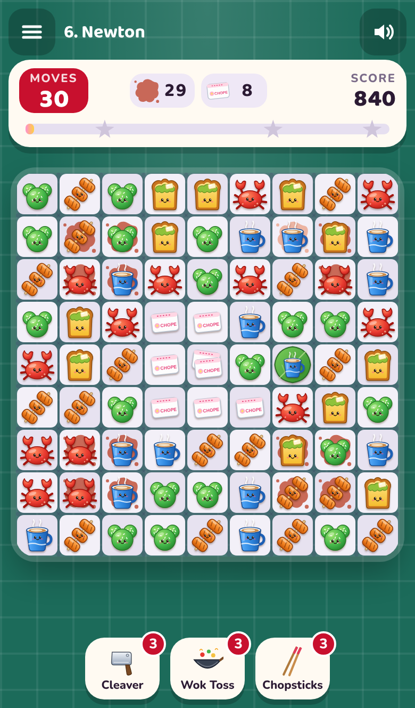

# Hawker Crush

A match-3 game inspired by Candy Crush, served with Singapore hawker food. Match chilli crab, satay, kaya toast, ondeh-ondeh, teh tarik and kueh lapis across eight famous hawker centres, from Maxwell to Amoy Street.

It is a Progressive Web App: install it on your phone's home screen and it opens full screen and plays offline.



## Features

- **8 levels** with move limits, goals and 1 to 3 stars
- **Special pieces:** striped (match 4), banana-leaf wrapped (L or T shape, explodes twice), Ice Kacang colour bomb (match 5), plus combos when two specials are swapped
- **Obstacles:** sambal stains, "chope" tissue packets and tapao bags
- **Boosters:** Cleaver, Wok Toss and Chopsticks
- **Swipe or tap-tap controls**, sized for phones
- **Synthesised sound effects and music** (Web Audio, no audio files), each with its own mute toggle
- **Progress saved** on the device (localStorage)
- **Installable and offline:** web app manifest, service worker, self-hosted fonts

## Install on your phone

1. Open the deployed site.
2. **Android (Chrome):** tap **Install app** on the title screen, or use the browser menu and choose **Install app**.
3. **iPhone/iPad (Safari):** tap **Share**, then **Add to Home Screen**. The **Install app** button shows these steps too.

## Project structure

```
index.html              App shell
css/style.css           Styles and @font-face rules
js/art.js               Hand-built SVG food illustrations
js/game.js              Board engine, levels, audio, rendering, input
js/ui.js                Screens, HUD, modals, boosters
js/pwa.js               Service worker registration and install prompt
sw.js                   Offline cache (stale-while-revalidate)
manifest.webmanifest    PWA manifest
icons/                  App icon (SVG master + PNG sizes, maskable, Apple touch)
fonts/                  Baloo 2 and Nunito (SIL Open Font License 1.1)
screenshots/            Store-style screenshots used by the manifest
vercel.json             Headers for the service worker, manifest and fonts
```

There is no build step: it is plain HTML, CSS and JavaScript.

## Run locally

```bash
npx serve .
# or
python3 -m http.server 8080
```

Open http://localhost:8080. The service worker only runs over `http://localhost` or HTTPS, not from `file://`.

## Deploy to Vercel

1. Import this repository at https://vercel.com/new.
2. Leave **Framework Preset** as **Other**, with no build command and the output directory at the project root.
3. Deploy. Vercel serves it over HTTPS, which installing a PWA requires.

Or from the command line: `npx vercel --prod`.

## Releasing an update

Bump `VERSION` in `sw.js` whenever you change any file. Installed copies download the new files in the background and use them the next time the game is opened.

## Credits

Game design, code and illustrations made with Claude. Fonts: [Baloo 2](https://github.com/EkType/Baloo2) and [Nunito](https://github.com/googlefonts/nunito), both under the SIL Open Font License 1.1 (licence texts in `fonts/`).
